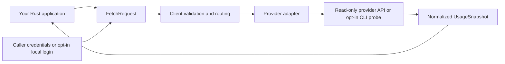

<p align="center">
  <br>
  AI account usage, quotas, balances, and reset times for Rust applications.<br><br>
  <a href="https://github.com/dhanushk-offl/agentstat/actions/workflows/ci.yml"></a>
  <a href="https://crates.io/crates/agentstat"></a>
  <a href="https://docs.rs/agentstat"></a>
  <a href="LICENSE"></a>
  <a href="docs/development.md"></a>
  <a href="#currently-supported"></a>
  <a href="https://scorecard.dev/viewer/?uri=github.com/dhanushk-offl/agentstat"></a><br><br>
  <a href="#quick-start">Quick start</a> ·
  <a href="#how-it-works">How it works</a> ·
  <a href="#examples">Examples</a> ·
  <a href="#currently-supported">Supported providers</a> ·
  <a href="#coming-soon">Coming soon</a> ·
  <a href="docs/usage.md">Usage guide</a> ·
  <a href="https://github.com/dhanushk-offl/agentstat/wiki">Wiki</a> ·
  <a href="#contributions-wanted">Contribute</a>
</p>

Fetch provider-reported data through one async API and use it in your own CLI,
dashboard, or application. agentstat is a library: your application decides when
to fetch, where to store results, and how to display them.

- Quota windows, utilization, limits, and reset times when the provider reports them.
- Exact decimal balances and spend, with currencies and credit units kept separate.
- Typed errors and batch fetching with bounded concurrency.
- Caller-supplied credentials, with explicit opt-in for local files and CLI probes.

**Early release: `0.1.0`.** The catalog tracks **42 implemented**, **60 planned**,
and **4 out-of-scope** providers. Implemented adapters have synthetic request and
normalization fixtures. [Help us validate more providers with real accounts](#contributions-wanted).
HTTP adapters target Linux, macOS, and Windows. Local CLI probes support Unix.
The table reflects the current source checkout. OpenCode Go, Ollama legacy quotas,
and optional Zen balance for Go subscribers will be available on crates.io in the
next release; use a local path dependency to try them now.

## Quick start

Add the published library to your Rust application:

```sh
cargo add agentstat@0.1.0 --features local-files
cargo add tokio --features macros,rt-multi-thread
```

Or put the same dependencies in `Cargo.toml`:

```toml
[dependencies]
agentstat = { version = "0.1.0", features = ["local-files"] }
tokio = { version = "1", features = ["macros", "rt-multi-thread"] }
```

This `src/main.rs` reads your existing Codex CLI login and prints the reported
quota windows. `local-files` is opt-in at both build time and runtime:

```rust
use agentstat::{Client, ProviderId, local::CredentialLocation};

#[tokio::main]
async fn main() -> Result<(), Box<dyn std::error::Error>> {
    let client = Client::builder().allow_local_files(true).build()?;
    let request = client
        .load_local_credentials(ProviderId::Codex, CredentialLocation::Native)
        .await?;
    let snapshot = client.fetch(request).await?;

    for window in &snapshot.windows {
        println!("{} | model: {}",
            window.id,
            window.model.as_deref().unwrap_or("not specified"));
        if let Some(percent) = window.utilization_percent {
            println!("  Used: {percent:.1}%");
        }
        if let Some(reset) = window.resets_at {
            println!("  Resets: {reset}");
        }
    }
    Ok(())
}
```

Run it with `cargo run`. For a fuller model-window report, copy or adapt
[the model usage example](examples/model_usage.rs). A `model` field identifies a
provider-reported model or group; a missing field does not imply a separate
per-model measurement. Five-hour and weekly windows are quota periods, not time
spent coding. The provider may omit a limit, reset, or model breakdown.

Codex and Claude are enabled by default. Select other integrations by their
**feature ID** in the table below, for example:

```toml
agentstat = { version = "0.1.0", default-features = false, features = ["cursor", "local-files"] }
```

`all-providers` enables every catalog feature, including planned integrations that
still return an unsupported error. Enable only the providers you need.

## How it works



Your application owns credentials, fetch timing, caching, and display. `Client`
checks provider support and account scope, performs a fetch, and returns typed
`windows`, `balances`, `spend`, and `warnings`. Reuse one `Client` for connection
pooling. `fetch_many` keeps request order and returns one result per request, so
one failed account does not hide another account's result.

## Examples

| Use case | Example | What it shows |
| --- | --- | --- |
| Model and quota windows from a local CLI login | [model_usage.rs](examples/model_usage.rs) | Read Codex, Claude, or Cursor credentials, then inspect model labels, utilization, limits, and resets |
| Live usage from your available accounts | [real_usage.rs](examples/real_usage.rs) | Codex, Claude, Cursor, Antigravity, OpenCode Go/Zen, and Ollama with their distinct credential paths |
| Caller-supplied token | [fetch.rs](examples/fetch.rs) | Supply a token and serialize the typed snapshot as JSON |

These examples use the public crate API, so their `Client` and `FetchRequest`
code can be moved into another Rust project. The first two examples run from this
repository with `cargo run --example ...`; `fetch.rs` needs `AGENTSTAT_TOKEN`.
For a model-window report from your existing Codex login, run:

```sh
cargo run --features local-files --example model_usage -- codex
```

## Try your real account

From this repository, after signing into the corresponding CLI:

| Account | Live command | Credentials used |
| --- | --- | --- |
| Codex | `cargo run --features local-files --example real_usage -- codex` | Existing local OAuth login |
| Claude Code | `cargo run --features local-files --example real_usage -- claude` | Existing local OAuth credential file |
| Cursor / `agent` | `cargo run --features cursor,local-files --example real_usage -- cursor` | Existing CLI `auth.json` |
| Antigravity / `agy` | `cargo run --features antigravity,local-probes --example real_usage -- agy` | Installed CLI login; Unix only |
| OpenCode Zen / Console | `cargo run --features opencode --example real_usage -- opencode` | Console cookie supplied in `OPENCODE_COOKIE` |
| OpenCode Go | `cargo run --features opencodego --example real_usage -- go` | Go API key supplied in `OPENCODE_GO_API_KEY` |
| Ollama Cloud | `cargo run --features ollama --example real_usage -- ollama` | Cloud API key supplied in `OLLAMA_API_KEY` |

The examples fetch live data and return an error if the fetch fails. They never
substitute demonstration values. OpenCode Zen/Console needs a Console cookie;
OpenCode Go uses its API key. Some CLI logins use OS credential stores that agentstat
does not read. See the [usage guide](docs/usage.md) for cookie setup, native file
paths, account selection, direct token access, and platform restrictions.

## Currently supported

**42 providers**, with 41 remote adapters and two optional local probes
(Antigravity supports both paths). Each row describes the data implemented today;
not every provider exposes hourly or weekly limits.

The **test coverage** status describes automated coverage. **Extended tests**
means multiple dedicated provider scenarios beyond the shared request and
normalization fixtures. **Fixture tests** means those shared fixtures cover the
provider's request and normalized result. [Real-account checks are welcome](#contributions-wanted)
for every provider.

| Provider | Feature ID | Test coverage | Available data |
| --- | --- | --- | --- |
| Codex | `codex` | Extended tests | Five-hour, weekly, and additional quotas; credits and resets |
| Claude | `claude` | Extended tests | Subscription quotas, model windows, extra usage; Admin costs |
| Cursor | `cursor` | Extended tests | CLI or dashboard usage, plan allowances, on-demand spend and resets |
| Antigravity | `antigravity` | Extended tests | Grouped five-hour/weekly quotas and resets; optional `agy` probe |
| OpenCode Zen / Console | `opencode` | Extended tests | Console Go quotas; Zen PAYG spend and prepaid balance |
| OpenCode Go | `opencodego` | Extended tests | Key-authenticated five-hour, weekly, and monthly percentages and resets |
| OpenAI | `openai` | Extended tests | Organization costs through the Admin API |
| ClinePass | `clinepass` | Fixture tests | Five-hour, weekly, and monthly quotas |
| Gemini app | `gemini` | Fixture tests | Model quota buckets using an existing bearer token |
| Copilot | `copilot` | Fixture tests | Monthly quota snapshots and reported unlimited allowances |
| z.ai / GLM | `zai` | Fixture tests | Token, time, and credit quotas |
| Moonshot / Kimi Open Platform | `moonshot` | Fixture tests | Available, cash, and voucher balances |
| Langdock | `langdock` | Fixture tests | Session and weekly quotas using a supplied cookie |
| Ollama | `ollama` | Extended tests | Monthly included credits or legacy session/weekly quotas; purchased balance |
| Synthetic | `synthetic` | Fixture tests | Quota arrays; five-hour, weekly, and hourly search windows |
| OpenRouter | `openrouter` | Fixture tests | Key quota; daily, weekly, monthly, and lifetime spend |
| ElevenLabs | `elevenlabs` | Fixture tests | Character and voice-slot quotas |
| Warp | `warp` | Fixture tests | Request quota |
| DeepSeek | `deepseek` | Fixture tests | Balances by currency |
| Codebuff | `codebuff` | Fixture tests | Credit quota and available balance |
| Venice | `venice` | Fixture tests | USD and DIEM balances |
| Poe | `poe` | Fixture tests | Points balance |
| ClawRouter | `clawrouter` | Fixture tests | Monthly budget quota and reported spend |
| ZenMux | `zenmux` | Fixture tests | Five-hour and weekly quotas |
| xAI | `xai` | Fixture tests | Prepaid balance |
| Nous Portal | `nous` | Fixture tests | Subscription quota and balances |
| CodeRabbit | `coderabbit` | Fixture tests | Review count and plan through an opt-in Unix CLI probe |
| GitKraken AI | `gitkraken` | Fixture tests | Personal and organization quotas |
| DevPass | `devpass` | Fixture tests | Key, plan, and weekly premium quotas |
| Atlas Cloud | `atlascloud` | Fixture tests | Available balance |
| Vercel AI Gateway | `vercel` | Fixture tests | Available balance and lifetime spend |
| xKiro | `xkiro` | Fixture tests | Daily free-token quota |
| Tavily | `tavily` | Fixture tests | Plan, key, and PAYG quotas |
| Linkup | `linkup` | Fixture tests | Available balance |
| Exa | `exa` | Fixture tests | Month-to-date spend |
| Cosmic AI | `cosmic` | Fixture tests | Numeric input and output quotas |
| Aerostack | `aerostack` | Fixture tests | Monthly token quota |
| Sail Research | `sailresearch` | Fixture tests | Reported 30-day spend and available balance |
| Sofya | `sofya` | Fixture tests | Credit, plan-credit, and purchased-credit balances |
| fal | `fal` | Fixture tests | Available balance |
| FLORA | `flora` | Fixture tests | Available balance and monthly spend |
| Munito | `munito` | Fixture tests | Admin daily/monthly spend and limits |

For endpoint details, authentication restrictions, and omitted enrichments, see
[full provider coverage](docs/providers.md). The
[coverage manifest](docs/coverage.json) records the status of every catalog entry.

## Coming soon

**60 integrations are planned.** They have catalog IDs and Cargo features, but no
working fetch adapter yet. This is a backlog, with no promised release order or
dates. Contributions are welcome.

<details>
<summary>View all planned providers</summary>

| Provider | Planned feature ID |
| --- | --- |
| Alibaba Coding Plan | `alibaba` |
| Alibaba Token Plan | `alibabatokenplan` |
| Qwen Cloud | `qwencloud` |
| Droid | `factory` |
| Fireworks | `fireworks` |
| Devin | `devin` |
| MiniMax | `minimax` |
| Manus | `manus` |
| Kimi | `kimi` |
| Kilo | `kilo` |
| Kiro | `kiro` |
| Vertex AI | `vertexai` |
| Augment | `augment` |
| JetBrains AI | `jetbrains` |
| Amp | `amp` |
| T3 Chat | `t3chat` |
| Windsurf | `windsurf` |
| Zed | `zed` |
| Perplexity | `perplexity` |
| Xiaomi MiMo | `mimo` |
| Sakana AI | `sakana` |
| Abacus AI | `abacus` |
| Mistral | `mistral` |
| DeepInfra | `deepinfra` |
| Command Code | `commandcode` |
| Qoder | `qoder` |
| StepFun | `stepfun` |
| AWS Bedrock | `bedrock` |
| Grok | `grok` |
| Groq | `groq` |
| LLM Proxy | `llmproxy` |
| LiteLLM | `litellm` |
| Bifrost | `bifrost` |
| Aixy | `aixy` |
| Deepgram | `deepgram` |
| Chutes | `chutes` |
| Neuralwatt | `neuralwatt` |
| Helmcode | `helmcode` |
| LongCat | `longcat` |
| sub2api | `sub2api` |
| Wayfinder | `wayfinder` |
| ai& | `aiand` |
| ZoomMate | `zoommate` |
| X API | `xapi` |
| Notion AI | `notion` |
| IBM Bob | `ibmbob` |
| Replicate | `replicate` |
| Hugging Face | `huggingface` |
| Raycast | `raycast` |
| v0 | `v0` |
| TypeSafe | `typesafe` |
| Charm Hyper | `hyper` |
| Future AGI | `futureagi` |
| llmman | `llmman` |
| Muse (muse.ai) | `museai` |
| LithosAI | `lithosai` |
| WorkBuddy | `workbuddy` |
| TinyApi | `tinyapi` |
| Parallel | `parallel` |
| Claude Platform | `claudeplatform` |

</details>

### Outside the current scope

These entries are excluded from the current implementation rather than scheduled
for release:

| Provider | Feature ID | Reason |
| --- | --- | --- |
| Azure OpenAI | `azureopenai` | The identified access probe requires inference. |
| Doubao | `doubao` | The identified validation path generates a chat completion. |
| Muse Code | `muse` | The identified authentication path creates an API key. |
| Pi | `pi` | Local transcript scanning and estimated cost history are outside this crate. |

## Contributions wanted

We need people with access to different providers to check agentstat against
their real usage pages. A successful check is useful too: it helps maintainers
spot endpoint or response changes and improve confidence in the adapters above.

| Help needed | How to contribute |
| --- | --- |
| Real-account checks | Run a [live example](#try-your-real-account), compare its results with the provider's usage page, then [share the result](https://github.com/dhanushk-offl/agentstat/issues/new?template=provider_check.yml). |
| Adapter fixes | If a provider's response differs, add a redacted synthetic fixture and a focused fix. See [contributing](CONTRIBUTING.md). |
| More providers | Pick an entry from [Coming soon](#coming-soon) and discuss its read-only usage endpoint before opening a pull request. |

For a field report, include the provider, crate version or commit, enabled
features, platform, credential type, date, and CLI version when relevant. Describe
what matched or differed without sharing tokens, cookies, account IDs, or raw
authenticated responses. The [contribution guide](CONTRIBUTING.md#live-provider-checks)
has a short checklist.

## Data and credentials

Quota windows describe allowance consumption, not hours actively spent coding.
Missing values stay missing; limits distinguish `Known`, `Unknown`, and
`Unlimited`. Monetary values use exact decimals serialized as strings. Quota
allowances and billed spend are separate concepts.

Pass a bearer token, API key, or full Cookie header as the provider requires.
The direct adapters do not log in, renew tokens, extract browser credentials, or
write credential files. Local file reads and probes require both a Cargo feature
and a runtime opt-in. An installed CLI owns its authentication and runtime behavior.

Fetches have a 30-second deadline and a 2 MiB HTTP response limit by default.
There are no automatic retries, redirects, or background polling. Errors omit
remote response bodies and credential values. Private provider APIs can change;
check the returned data against your provider's usage page.

## Documentation and community

| Resource | What you will find |
| --- | --- |
| [Usage guide](docs/usage.md) | Credentials, scopes, live examples, and transport options |
| [Wiki](https://github.com/dhanushk-offl/agentstat/wiki) | Installation, examples, troubleshooting, issues, and roadmap |
| [Provider coverage](docs/providers.md) | Data surfaces and restrictions for every provider |
| [Development guide](docs/development.md) | Architecture, feature checks, and packaging |
| [Release guide](docs/releasing.md) | Tag-triggered crates.io publishing and GitHub Releases |
| [Contributing](CONTRIBUTING.md) | Bug reports, provider adapters, and pull requests |
| [Code of conduct](CODE_OF_CONDUCT.md) | Community expectations and reporting concerns |
| [Security policy](SECURITY.md) | Reporting vulnerabilities and credential exposure |

Support development through [GitHub Sponsors](https://github.com/sponsors/dhanushk-offl)
or [Buy Me a Coffee](https://www.buymeacoffee.com/itzmedhanu).

Run the local checks:

```sh
cargo fmt --check
cargo test --all-features
cargo test --no-default-features
cargo clippy --all-features --all-targets -- -D warnings
python3 scripts/check_coverage.py
```

The regular tests use synthetic fixtures and in-memory HTTP, with no live accounts
required. CI also runs socket smoke tests on Linux, macOS, and Windows.

## License

[MIT](LICENSE) © 2026 agentstat contributors.
